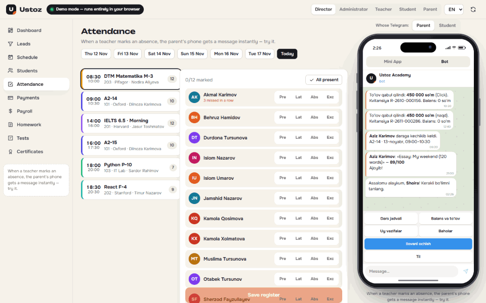
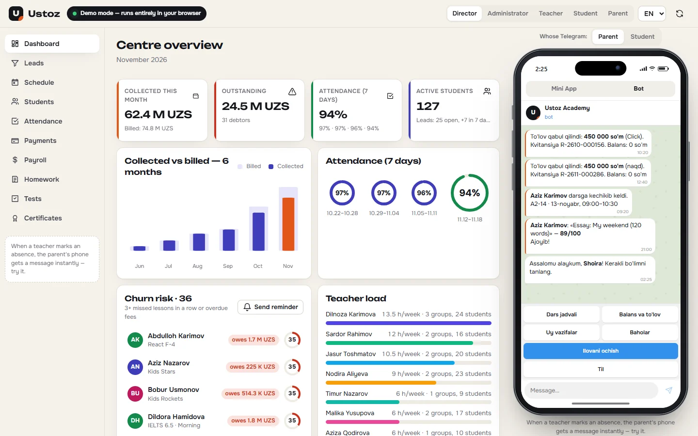
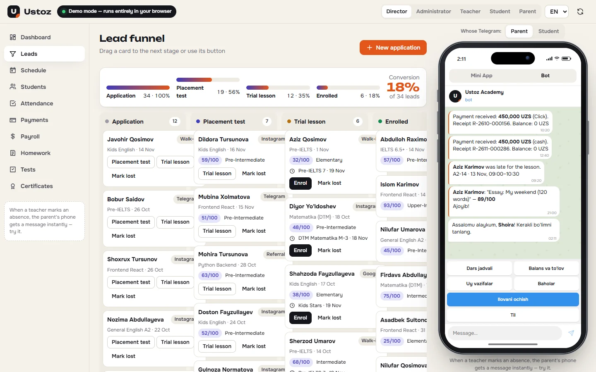
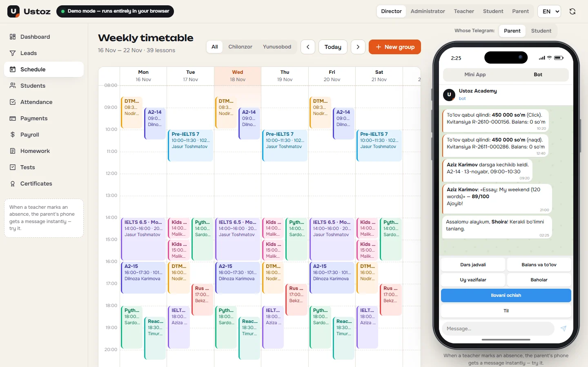
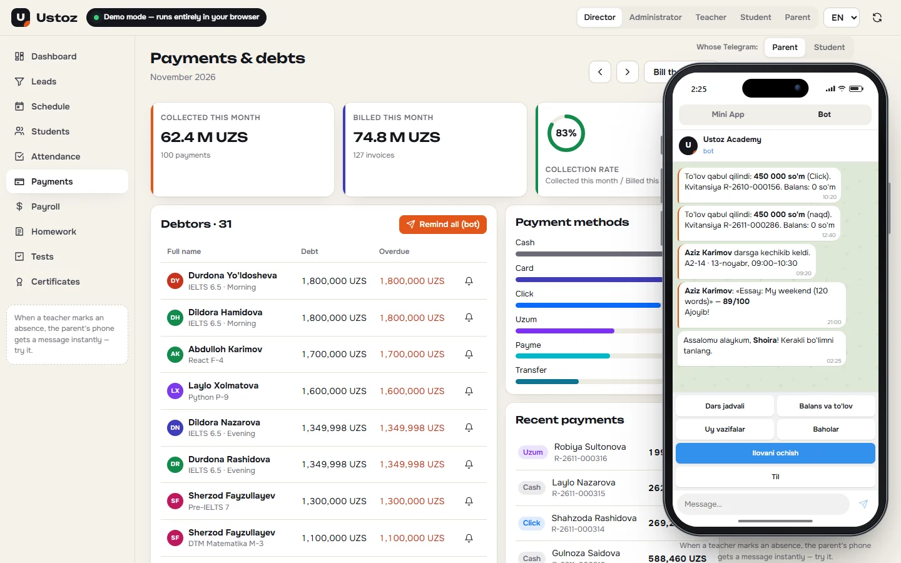
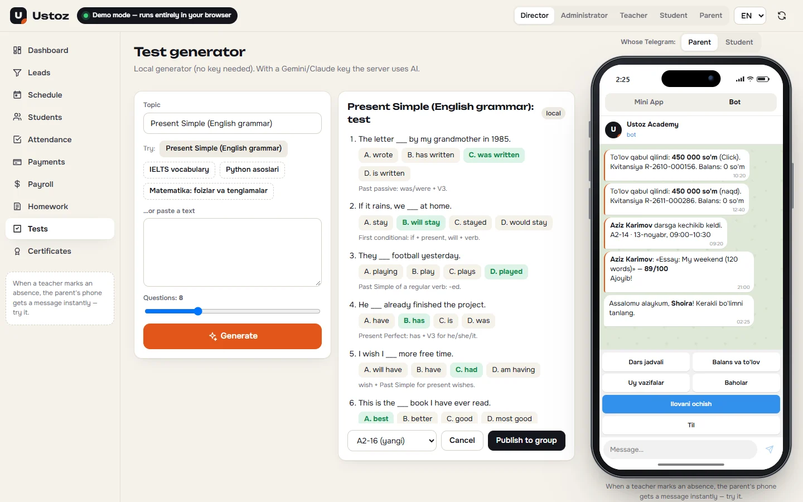
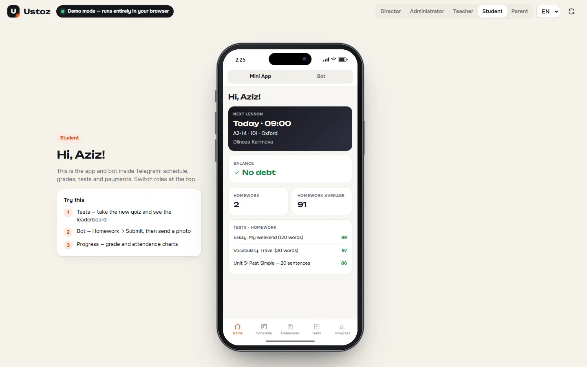
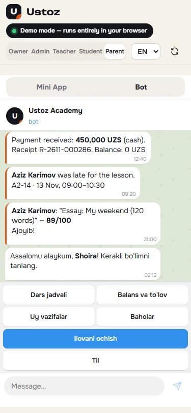
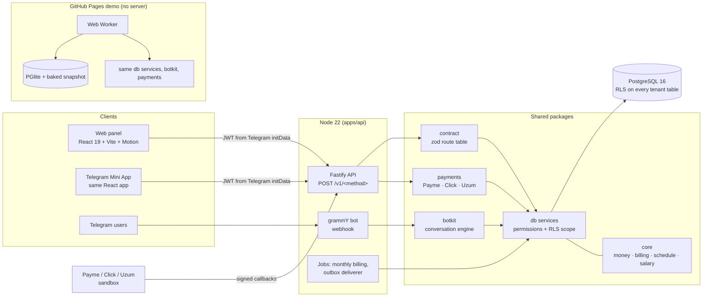

[English](README.md) · [O'zbekcha](README.uz.md)

# Ustoz — a learning-centre platform

**Web panel + Telegram bot + Telegram Mini App for private learning centres in Uzbekistan** (English, IELTS, IT, maths…).
Attendance with instant parent alerts, exact-to-the-tiyin billing with proration and discounts, Payme / Click / Uzum,
teacher payroll, a lead funnel, homework through the bot, auto-graded tests and verifiable certificates.

[](https://xoliddev.github.io/ustoz/)
[](https://github.com/xoliddev/ustoz/actions/workflows/ci.yml)
[](https://github.com/xoliddev/ustoz/actions/workflows/pages.yml)
[](LICENSE)

**▶ [Open the live demo](https://xoliddev.github.io/ustoz/)** — *Demo mode — runs entirely in your browser.* The real
PostgreSQL schema, the real services and the real bot engine run inside a Web Worker (PGlite). No server, no sign-up.
Switch roles at the top: Director, Administrator, Teacher, Student, Parent.



## Why

Centres here run on Modme, AlfaCRM, spreadsheets and a lot of phone calls. The recurring pains are always the same:
**unpaid fees**, **students quietly dropping out**, **parents who learn about absences a month later**, **timetable
clashes** and **payroll done by hand**. Ustoz goes after each of them:

| Pain | What Ustoz does |
|---|---|
| Parents find out too late | The moment a teacher marks *absent* or *late*, every parent of that child gets a Telegram message — written in the same database transaction (transactional outbox), so "marked" and "notified" can never disagree. |
| Debts pile up | Monthly invoices are generated automatically, prorated by lessons for mid-month joins, with sibling and prepay discounts. One tap sends reminders through the bot; parents pay in the Mini App with Payme, Click or Uzum. |
| Silent drop-outs | Churn risk on the dashboard: 3+ missed lessons in a row or overdue fees, with a score to sort by. |
| Timetable clashes | Room and teacher conflicts are detected live while you create a group (checked on real calendar dates, not just weekdays). |
| Payroll by hand | Fixed, per-student or percent-of-collected-fees salaries, computed from actual payments, to the tiyin. |
| Leads lost in DMs | Application → placement test → trial lesson → enrolled, as a drag-and-drop kanban with conversion rates. |

## Features

**Director / Administrator (web)**
- Dashboard: collected vs billed (6 months), outstanding debt, attendance trend, churn-risk list, teacher load.
- Lead funnel kanban with placement score → suggested level, trial booking and one-click enrolment (student, parent and first prorated invoice in one transaction).
- Weekly timetable for all branches and rooms, with lanes for parallel lessons and a group form that flags room/teacher clashes as you type.
- Students: search, filters (at risk, debtors), profile with family, attendance strip, grade chart, invoices with discount lines, payments and receipts; take cash/card payments or a 3/6/12-month prepayment.
- Billing: month totals, collection rate, payment-method split, debtors with per-family bot reminders, printable receipts.
- Payroll report with per-group lines; the director can change each teacher's pay rule.
- Homework and tests across groups, certificates with QR codes.

**Teacher (web + Mini App)** — today's lessons, a one-tap register (present / late / absent / excused), homework grading, the test generator, own payslip.

**Student (Mini App + bot)** — next lesson, balance, homework (hand in from the app or by sending text/photo/file to the bot), tests taken inside the Mini App with instant grading and a leaderboard, progress charts.

**Parent (bot + Mini App)** — instant absence/late alerts, payment receipts, grades; schedule, balance and grades for every child; pay online in sandbox.

**Bot** — buttons only (no slash commands to remember), Uzbek by default with Russian and English, linking by the phone number shared through Telegram's contact button.

**Test generator** — from a topic or pasted text. The demo uses a deterministic local generator (curated banks + procedurally generated maths with computed answers + gap-fill from your text), so no key is needed. Behind the same interface, real **Claude** and **Gemini** adapters switch on when `ANTHROPIC_API_KEY` / `GEMINI_API_KEY` is set; model output is treated as untrusted and re-validated.

**Certificates** — printable, HMAC-signed, with a QR code to a public verification page that recomputes the signature (an edited certificate shows as invalid).

## Screenshots

| | |
|---|---|
|  |  |
|  |  |
|  |  |

<p align="center"></p>

## Architecture



One route table (`packages/contract`) drives the Fastify server, the HTTP client and the demo worker, so all three
validate the same zod schemas. The demo loads a **pre-baked PGlite snapshot** (schema + people) and seeds the
date-dependent part — lessons, attendance, invoices, payments, homework — relative to *today*, in one bulk transaction.
A test seeds 14 consecutive days in three windows (from today, across New Year, across a leap February) and checks
every persona's screens each day, so the demo can't silently break on a particular date.

## Real vs simulated

| Part | In the demo | In production |
|---|---|---|
| Database, migrations, RLS | **Real** — PostgreSQL (PGlite) in your browser, same SQL | PostgreSQL 16 |
| Business logic (billing, payroll, conflicts, churn, funnel) | **Real** — the same `@ustoz/db` services | same |
| Telegram login | **Real HMAC check** of initData signed with a demo token | initData signed by Telegram, freshness enforced |
| Bot conversations | **Real engine** (`@ustoz/botkit`) in a simulated chat | grammY on a webhook with a secret token |
| Notifications | **Real outbox rows**, rendered with the real templates | delivered by the bot (`sendMessage`), retried up to 5× |
| Payme / Click / Uzum | **Real adapters**; the provider's side is *played* in sandbox with valid signatures | provider sandbox/test credentials only (`PAYMENTS_MODE=sandbox`) |
| Test generator | Deterministic local generator | Claude or Gemini when a key is set, local otherwise |
| Files (homework photos) | Stored inline as data URLs | Telegram `file_id` references |
| Persistence | In memory — **Reset** or reload starts fresh | durable |

## Security

- **Telegram initData**: HMAC-SHA256 with the bot token, constant-time compare, `auth_date` freshness (default 1 h for sign-in) and no future dates.
- **Tenant isolation**: every tenant table has `centre_id` and an RLS policy; each request runs `SET LOCAL ROLE ustoz_app` with `app.centre_id` set. Cross-tenant lookups (login, payment callbacks, public certificate check) go through narrow `SECURITY DEFINER` functions. A test proves another centre's rows are invisible and unwritable, and that the audit log is append-only.
- **Permissions on every method**: a role → permission matrix, plus ownership checks (a teacher only sees their groups, a parent only their children). The claimed role is re-checked against the database on every call, not trusted from the token.
- **Validation**: zod on every input (contract), zod on the environment; AI output re-validated.
- **Rate limits** per group (auth, public, AI, writes, reads, webhooks) with `Retry-After`.
- **Webhooks**: Payme Basic auth, Click MD5 `sign_string`, Uzum Basic auth, Telegram secret token — all compared in constant time; idempotent state machines; Telegram update ids processed once.
- **Money**: integer tiyin everywhere, BigInt for multiplication, largest-remainder allocation so prorated parts add up exactly.
- **Secrets** only from the environment; `.env.example` holds placeholders. Payments refuse any mode other than `sandbox`.
- Security headers (CSP, nosniff, frame-deny, no-store), CORS allow-list, body limits, log redaction.

## Quick start

```bash
npm ci
npm run dev                 # demo at http://localhost:4180 (backend in a Web Worker)
npm run build:demo          # bake the snapshot + build the Pages bundle
npm run preview -w @ustoz/web   # http://localhost:4181/ustoz/
```

Run the API with PostgreSQL:

```bash
cp .env.example .env        # fill JWT_SECRET, CERT_SECRET (openssl rand -hex 32), BOT_TOKEN…
docker compose up --build   # API on http://localhost:4182 (healthz, /v1/*, /hooks/*)
```

| Variable | Required | Meaning |
|---|---|---|
| `DATABASE_URL` | yes | PostgreSQL connection string (the role owns the schema and runs migrations) |
| `JWT_SECRET` | yes | ≥ 32 chars, signs 1-hour access tokens |
| `CERT_SECRET` | yes | ≥ 32 chars, HMAC key for certificates |
| `BOT_TOKEN` | no | Telegram bot token; enables the bot and Mini App login |
| `BOT_WEBHOOK_SECRET` | with bot | secret token Telegram echoes on `/hooks/telegram` |
| `PUBLIC_URL`, `MINIAPP_URL` | no | public URLs (QR links point to `MINIAPP_URL/#/verify/<code>`) |
| `CORS_ORIGINS` | no | comma-separated allowed origins |
| `INITDATA_MAX_AGE_SEC` | no | sign-in freshness window (default 3600) |
| `PAYMENTS_MODE` | no | must be `sandbox` |
| `PAYME_MERCHANT_ID`, `PAYME_TEST_KEY` | no | Payme sandbox |
| `CLICK_SERVICE_ID`, `CLICK_MERCHANT_ID`, `CLICK_SECRET_KEY` | no | Click sandbox |
| `UZUM_SERVICE_ID`, `UZUM_LOGIN`, `UZUM_PASSWORD` | no | Uzum sandbox |
| `ANTHROPIC_API_KEY` / `GEMINI_API_KEY` | no | real AI test generation |
| `TRUST_PROXY` | no | `true` behind a reverse proxy |

## Tests

```bash
npm test                                   # all vitest suites (PGlite)
TEST_DATABASE_URL=postgres://… npm test     # DB, API and bot suites also against PostgreSQL
npm run build:demo && PW_CHANNEL=chrome npm run e2e   # Playwright, 1440 px and 375 px
```

<!-- TESTS-TABLE -->

Property tests (fast-check) cover money allocation, proration (two halves of a month always add up to the fee),
discounts, settlement, payroll and schedule conflicts (checked against a brute-force minute-by-minute model).
The e2e suite fails on any console error.

## Project layout

```
packages/core       money, dates, billing, salary, schedule conflicts, churn, funnel, initData, test generator
packages/db         SQL migrations (RLS), PG + PGlite adapters, application services
packages/contract   zod route table shared by server, client and demo
packages/payments   Payme / Click / Uzum adapters + sandbox player
packages/botkit     bot conversation engine (Telegram-agnostic)
packages/i18n       bot and web copy (uz / ru / en)
packages/seed       demo centre, dated relative to today
apps/api            Fastify server, auth, rate limits, webhooks, jobs
apps/bot            grammY adapter and outbox deliverer
apps/web            React app: panel, Mini App, simulated bot chat, demo shell
e2e                 Playwright tests
```

## Licence

[MIT](LICENSE) © 2026 xoliddev
