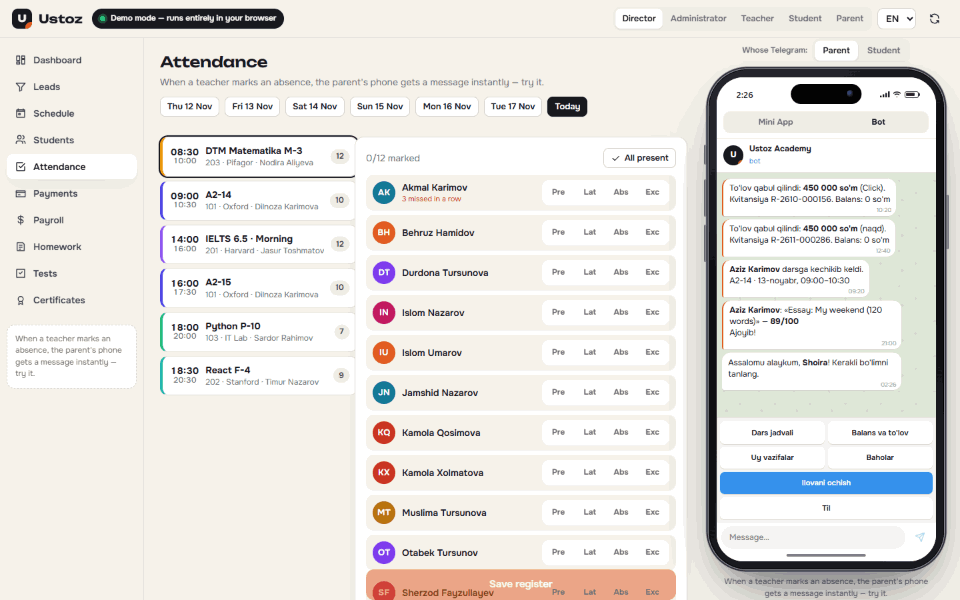
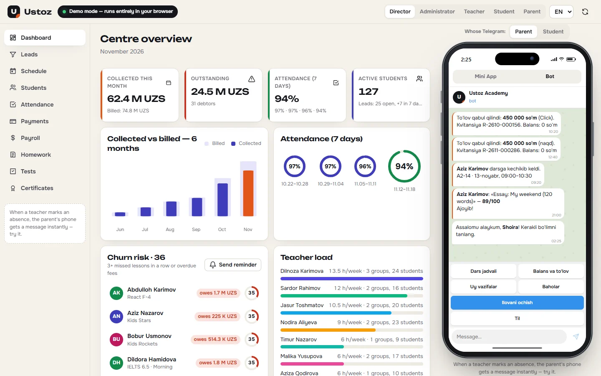
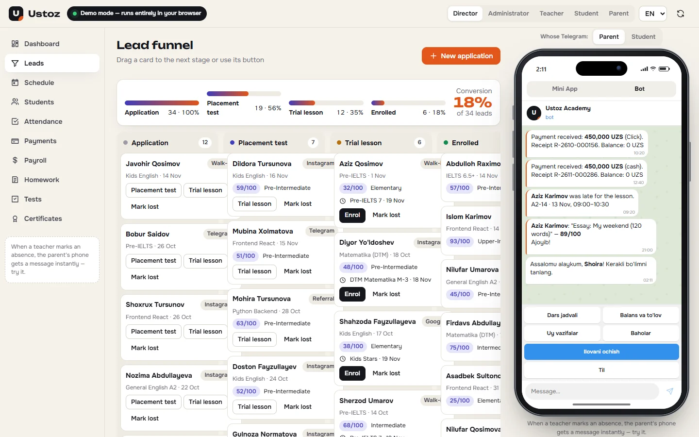
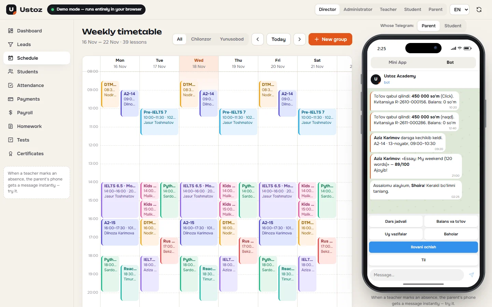
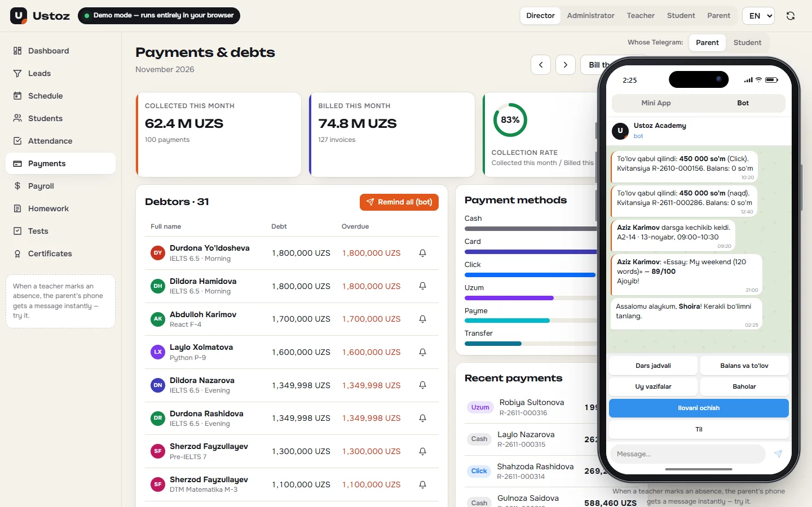
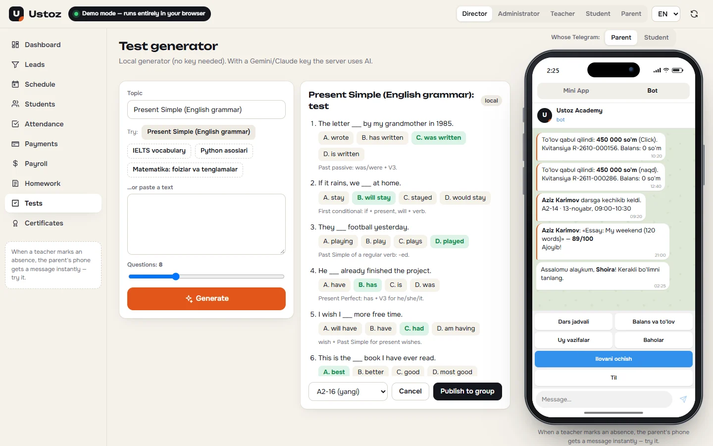
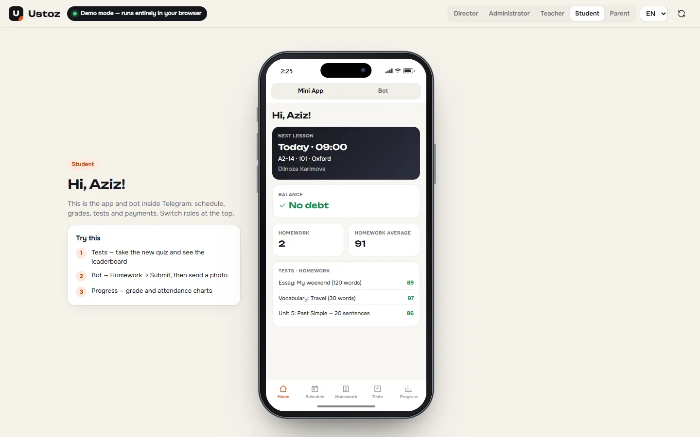
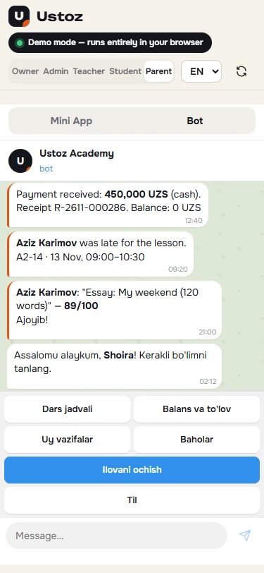

[English](README.md) · [O'zbekcha](README.uz.md)

# Ustoz — o'quv markazlari uchun platforma

**Xususiy o'quv markazlari uchun web-panel, Telegram bot va Telegram Mini App** (ingliz tili, IELTS, IT, matematika…).
Davomat va ota-onaga darhol xabar, tiyinigacha aniq to'lov hisobi (oy o'rtasida qo'shilganda qayta hisoblash va
chegirmalar bilan), Payme / Click / Uzum, o'qituvchilar ish haqi, lidlar voronkasi, bot orqali uy vazifa, avtomatik
tekshiriladigan testlar va QR kod bilan tekshiriladigan sertifikatlar.

[](https://xoliddev.github.io/ustoz/)
[](https://github.com/xoliddev/ustoz/actions/workflows/ci.yml)
[](https://github.com/xoliddev/ustoz/actions/workflows/pages.yml)
[](LICENSE)

**▶ [Jonli demoni ochish](https://xoliddev.github.io/ustoz/)** — *Demo rejim — hammasi brauzeringizda ishlaydi.*
Haqiqiy PostgreSQL sxemasi, haqiqiy servislar va botning haqiqiy mantig'i brauzer ichida (Web Worker, PGlite) ishlaydi.
Server yo'q, ro'yxatdan o'tish shart emas. Yuqoridan rolni tanlang: direktor, administrator, o'qituvchi, o'quvchi, ota-ona.



## Nega kerak

Ko'p markazlar Modme, AlfaCRM, Excel jadvallar va cheksiz qo'ng'iroqlar bilan ishlaydi. Muammolar esa doim bir xil:
**to'lanmagan to'lovlar**, **jimgina ketib qolayotgan o'quvchilar**, **farzandi darsga kelmaganini bir oydan keyin
biladigan ota-onalar**, **jadvaldagi to'qnashuvlar** va **qo'lda hisoblanadigan ish haqi**. Ustoz har biriga javob beradi:

| Muammo | Ustoz nima qiladi |
|---|---|
| Ota-ona kech biladi | O'qituvchi «kelmadi» yoki «kechikdi» deb belgilagan zahoti bolaning har bir ota-onasiga Telegramda xabar boradi. Xabar davomat bilan bitta tranzaksiyada yoziladi — «belgilandi, lekin xabar ketmadi» degan holat bo'lmaydi. |
| Qarzlar yig'ilib qoladi | Har oy hisoblar avtomatik yaratiladi: oy o'rtasida qo'shilganda faqat qolgan darslar uchun, aka-uka va oldindan to'lov chegirmalari bilan. Bir tugma bilan bot orqali eslatma ketadi, ota-ona Mini App'da Payme, Click yoki Uzum orqali to'laydi. |
| Jimgina ketib qolish | Bosh sahifada xavf ro'yxati: ketma-ket 3+ dars qoldirgan yoki muddati o'tgan qarzi bor o'quvchilar, ball bo'yicha saralangan. |
| Jadvaldagi to'qnashuv | Guruh yaratayotganda xona yoki o'qituvchi band bo'lsa, shu zahoti ko'rsatiladi (hafta kuni emas, haqiqiy sanalar bo'yicha tekshiriladi). |
| Ish haqi qo'lda | Belgilangan oylik, har bir o'quvchi uchun yoki tushgan to'lovdan foiz — haqiqiy to'lovlardan, tiyinigacha hisoblanadi. |
| Lidlar yo'qolib ketadi | Ariza → daraja testi → sinov darsi → o'qiyapti: sudrab o'tkaziladigan kanban va konversiya foizi. |

## Imkoniyatlar

**Direktor / administrator (web)**
- Bosh sahifa: 6 oylik tushum va hisob, umumiy qarz, davomat dinamikasi, ketib qolish xavfi, o'qituvchilar yuklamasi.
- Lidlar kanbani: test balli bo'yicha daraja tavsiyasi, sinov darsiga yozish va bir bosishda guruhga qo'shish (o'quvchi, ota-ona va birinchi hisob bitta tranzaksiyada).
- Barcha filial va xonalar uchun haftalik jadval; yangi guruh formasi to'qnashuvni yozayotganingizdayoq ko'rsatadi.
- O'quvchilar: qidiruv, filtrlar (xavf ostida, qarzdorlar), oila, davomat, baholar grafigi, chegirmalari ko'rinib turadigan hisoblar, to'lovlar va kvitansiyalar; naqd/karta to'lov yoki 3/6/12 oylik oldindan to'lov.
- To'lovlar: oy yakuni, yig'ilish darajasi, to'lov usullari, qarzdorlarga bot orqali eslatma, chop etiladigan kvitansiya.
- Ish haqi hisoboti guruhlar kesimida; direktor har bir o'qituvchining shartini o'zgartira oladi.
- Uy vazifa va testlar, QR kodli sertifikatlar.

**O'qituvchi (web + Mini App)** — bugungi darslar, bir bosishda davomat (keldi / kechikdi / kelmadi / sababli), uy vazifani baholash, test generatori, o'z ish haqi.

**O'quvchi (Mini App + bot)** — keyingi dars, balans, uy vazifa (ilovadan yoki botga matn/rasm/fayl yuborib topshiriladi), Mini App ichida test va darhol natija, reyting, o'sish grafiklari.

**Ota-ona (bot + Mini App)** — kelmagani yoki kechikkani haqida darhol xabar, kvitansiyalar, baholar; har bir farzand uchun jadval, balans va baholar; onlayn to'lov (sandbox).

**Bot** — faqat tugmalar («/» buyruqlarni eslab qolish shart emas), asosiy til o'zbekcha, ruscha va inglizcha ham bor; foydalanuvchi Telegram'ning «raqamni yuborish» tugmasi orqali o'z yozuviga bog'lanadi.

**Test generatori** — mavzu yoki joylangan matndan. Demoda kalit talab qilmaydigan lokal generator ishlaydi (tayyor savollar banki, javobi hisoblab chiqiladigan matematik misollar va matndan «bo'sh joyni to'ldiring»). Xuddi shu interfeys ortida haqiqiy **Claude** va **Gemini** adapterlari bor: `ANTHROPIC_API_KEY` yoki `GEMINI_API_KEY` qo'yilsa yoqiladi; AI javobi ishonchsiz deb qaraladi va qayta tekshiriladi.

**Sertifikatlar** — chop etiladi, HMAC bilan imzolanadi, QR kod ochiq tekshirish sahifasiga olib boradi; u yerda imzo qayta hisoblanadi, o'zgartirilgan sertifikat «haqiqiy emas» deb chiqadi.

## Skrinshotlar

| | |
|---|---|
|  |  |
|  |  |
|  |  |

<p align="center"></p>

## Arxitektura

Arxitektura sxemasi (mermaid) [inglizcha README](README.md#architecture)da. Qisqasi: bitta marshrutlar jadvali
(`packages/contract`, zod) Fastify serveri, HTTP-klient va demo worker uchun umumiy. Barcha biznes-mantiq
`packages/db` servislarida; ular serverda PostgreSQL 16 bilan, demoda esa brauzerdagi PGlite bilan ishlaydi. Bot
mantig'i `packages/botkit`da — grammY ham, demodagi chat ham aynan shuni chaqiradi.

Demo **oldindan tayyorlangan PGlite snapshot**ni yuklaydi (sxema va odamlar), sanaga bog'liq qismini esa — darslar,
davomat, hisoblar, to'lovlar, uy vazifalar — *bugungi* kunga nisbatan bitta tranzaksiyada yaratadi. Test 14 kun ketma-ket
uch oraliqda (bugundan, Yangi yil orqali, kabisa yilidagi fevral orqali) ma'lumot yaratib, har kuni har bir rolning
asosiy ekranlarini tekshiradi — demo biror sanada to'satdan buzilib qolmaydi.

## Haqiqiy va simulyatsiya

| Qism | Demoda | Ishlab chiqarishda |
|---|---|---|
| Baza, migratsiyalar, RLS | **Haqiqiy** — brauzerdagi PostgreSQL (PGlite), aynan shu SQL | PostgreSQL 16 |
| Biznes-mantiq (to'lov, ish haqi, to'qnashuv, xavf, voronka) | **Haqiqiy** — o'sha `@ustoz/db` servislari | xuddi shu |
| Telegram orqali kirish | **Haqiqiy HMAC tekshiruvi** (demo token bilan imzolangan initData) | Telegram imzolagan initData, eskirganlik tekshiriladi |
| Bot suhbatlari | **Haqiqiy mantiq** (`@ustoz/botkit`), simulyatsiya qilingan chatda | grammY, maxfiy tokenli webhook |
| Xabarnomalar | **Haqiqiy outbox yozuvlari**, haqiqiy shablonlar bilan | bot yuboradi, 5 martagacha qayta urinadi |
| Payme / Click / Uzum | **Haqiqiy adapterlar**; provayder tomoni sandbox'da to'g'ri imzolar bilan «o'ynaladi» | faqat test kalitlari (`PAYMENTS_MODE=sandbox`) |
| Test generatori | Lokal, deterministik | kalit bo'lsa Claude yoki Gemini |
| Fayllar (uy vazifa rasmi) | data URL sifatida saqlanadi | Telegram `file_id` |
| Saqlanish | Xotirada — «Yangilash» yoki sahifani qayta ochish boshidan boshlaydi | doimiy |

## Xavfsizlik

- **Telegram initData**: bot tokeni bilan HMAC-SHA256, doimiy vaqtli taqqoslash, `auth_date` eskirmaganligi (kirish uchun 1 soat) va kelajakdagi sana rad etiladi.
- **Markazlar ajratilgan**: har bir jadvalda `centre_id` va RLS siyosati bor; har so'rov `SET LOCAL ROLE ustoz_app` va `app.centre_id` bilan bajariladi. Test boshqa markaz ma'lumotini ko'rib ham, yozib ham bo'lmasligini va audit jurnalini o'chirib bo'lmasligini isbotlaydi.
- **Har bir metodda ruxsat**: rol → ruxsatlar jadvali va egalik tekshiruvi (o'qituvchi faqat o'z guruhlarini, ota-ona faqat o'z farzandlarini ko'radi). Rol har chaqiruvda bazadan qayta tekshiriladi.
- **Validatsiya**: har bir kirish zod bilan, muhit o'zgaruvchilari ham zod bilan; AI javobi qayta tekshiriladi.
- **So'rovlar chegarasi** guruhlar bo'yicha, `Retry-After` bilan.
- **Webhook'lar**: Payme Basic auth, Click MD5 `sign_string`, Uzum Basic auth, Telegram maxfiy tokeni; holatlar idempotent; Telegram yangilanishlari bir martagina qayta ishlanadi.
- **Pul**: hamma joyda butun tiyin, ko'paytirish BigInt'da, bo'laklar yig'indisi aynan summaga teng bo'ladi.
- **Maxfiy kalitlar** faqat muhitdan; `.env.example`da faqat namunalar. To'lov `sandbox`dan boshqa rejimda ishga tushmaydi.

## Tez boshlash

```bash
npm ci
npm run dev                 # demo: http://localhost:4180
npm run build:demo          # snapshot + Pages uchun build
npm run preview -w @ustoz/web   # http://localhost:4181/ustoz/
```

API'ni PostgreSQL bilan ishga tushirish:

```bash
cp .env.example .env        # JWT_SECRET, CERT_SECRET (openssl rand -hex 32), BOT_TOKEN… ni to'ldiring
docker compose up --build   # API: http://localhost:4182
```

| O'zgaruvchi | Majburiy | Ma'nosi |
|---|---|---|
| `DATABASE_URL` | ha | PostgreSQL ulanish satri |
| `JWT_SECRET` | ha | kamida 32 belgi, 1 soatlik tokenlarni imzolaydi |
| `CERT_SECRET` | ha | kamida 32 belgi, sertifikatlar uchun HMAC kalit |
| `BOT_TOKEN` | yo'q | Telegram bot tokeni; botni va Mini App orqali kirishni yoqadi |
| `BOT_WEBHOOK_SECRET` | bot bilan | `/hooks/telegram` uchun maxfiy token |
| `PUBLIC_URL`, `MINIAPP_URL` | yo'q | ochiq manzillar (QR kodlar `MINIAPP_URL/#/verify/<kod>`ga olib boradi) |
| `CORS_ORIGINS` | yo'q | ruxsat etilgan manbalar, vergul bilan |
| `INITDATA_MAX_AGE_SEC` | yo'q | kirish uchun initData muddati (standart 3600) |
| `PAYMENTS_MODE` | yo'q | faqat `sandbox` |
| `PAYME_*`, `CLICK_*`, `UZUM_*` | yo'q | provayderlarning test kalitlari |
| `ANTHROPIC_API_KEY` / `GEMINI_API_KEY` | yo'q | AI bilan test yaratish |
| `TRUST_PROXY` | yo'q | reverse proxy ortida `true` |

## Testlar

```bash
npm test                                   # barcha vitest to'plamlari (PGlite)
TEST_DATABASE_URL=postgres://… npm test     # baza, API va bot testlari PostgreSQL'da ham
npm run build:demo && PW_CHANNEL=chrome npm run e2e   # Playwright, 1440 px va 375 px
```

| To'plam | Testlar | Nimani tekshiradi |
|---|---:|---|
| core | 40 | pul, qayta hisoblash, chegirmalar, to'lovni taqsimlash, ish haqi, jadval to'qnashuvi (xossaviy testlar), sanalar, initData HMAC, MD5, ruxsatlar, xavf, voronka, test generatori |
| db | 12 | servislar oqimi boshidan oxirigacha, har bir jadvalda RLS, boshqa markazga kirishga urinishlar (PGlite; CI'da PostgreSQL 16 da ham) |
| api | 12 | Telegram orqali kirish (soxta / eskirgan / boshqa bot), ruxsatlar, validatsiya, CORS, so'rovlar chegarasi, Payme / Click / Uzum webhook'lari, Telegram maxfiy tokeni, muhit tekshiruvi |
| payments | 9 | Payme / Click / Uzum protokollari: avtorizatsiya, imzo, summa, idempotentlik, muddat, qaytarish, faqat sandbox |
| botkit | 6 | telefon orqali bog'lanish, ikki farzandli ota-ona, til almashtirish, matn va rasm bilan uy vazifa, o'qituvchi ko'rinishi |
| bot | 5 | grammY adapteri: klaviaturalar, takroriy yangilanishlar, faqat shaxsiy chat, callback'lar, outbox yetkazish |
| seed | 4 | demo 14 kun ketma-ket × 3 oraliqda (+ yarim tun chegarasi): qoidalar, har bir rol ekranlari, demo hisoblari = haqiqiy hisob-kitob kodi |
| contract | 4 | marshrutlar jadvali backend bilan aynan mos, faqat bitta ochiq metod, xato maydonni nomlaydi |
| i18n | 3 | har bir satr uz / ru / en tillarida bir xil o'rinbosarlar bilan, barcha xabar shablonlari, HTML ekranlash |
| web | 2 | interfeysdagi har bir matn kaliti mavjud |
| **e2e** (Playwright) | **15 × 2 o'lcham** | ishga tushish va belgi, telefon ramkasi va to'liq ekran, «kelmadi» → ota-onaga xabar, o'qituvchi Mini App'i, eslatma, ish haqi, jadval to'qnashuvi, naqd to'lov va kvitansiya, lidlar voronkasi (tugma va sudrash), test generatori → o'quvchi testi, onlayn to'lov (Click sandbox) va protokol, bot orqali uy vazifa → baholash, sertifikat va ochiq tekshiruv, botda til almashtirish |

Xossaviy testlar (fast-check) pulni taqsimlash, qayta hisoblash (oyning ikki yarmi doim to'liq summaga teng),
chegirmalar, to'lovlarni hisoblarga taqsimlash, ish haqi va jadval to'qnashuvlarini (daqiqama-daqiqa «qo'pol» model
bilan solishtirib) tekshiradi. E2E testlar konsolda bitta xato chiqsa ham yiqiladi.

## Litsenziya

[MIT](LICENSE) © 2026 xoliddev
